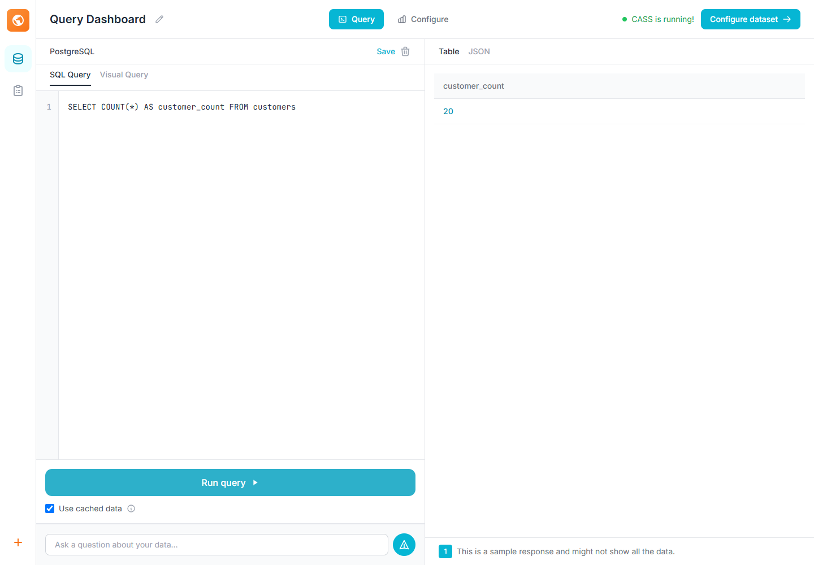

# CASS - Conversational AI SQL System

**A local AI-powered assistant for querying PostgreSQL databases using natural language.**

CASS lets you ask questions about your database in plain English. It uses a locally running Ollama language model to generate SQL, execute read-only queries, and present the results through an interactive web interface.

Inspect the generated SQL, review query results, or enter SQL directly when you prefer more control.



## Features

- **Natural-language queries:** Ask questions about your PostgreSQL database without writing SQL manually.
- **Local AI processing:** Use language models through Ollama instead of depending on a hosted LLM API.
- **SQL visibility:** Inspect the SQL generated by the assistant before relying on its output.
- **Interactive results:** View query results in the browser.
- **Streaming responses:** Receive assistant responses progressively through Server-Sent Events (SSE).
- **Direct SQL execution:** Submit SQL queries through the web interface.
- **Database awareness:** Retrieve database schema information to provide context for generated queries.
- **Read-only query controls:** Apply SQL validation, read-only transactions, result limits, and query timeouts.
- **API access:** Use the FastAPI backend independently of the frontend.

## Technology Stack

| Component | Technology |
| --- | --- |
| Frontend | JavaScript, Vite |
| Backend | Python, FastAPI |
| Database | PostgreSQL |
| AI integration | Ollama |
| SQL validation | SQLGlot |
| Database connectivity | asyncpg |
| API streaming | Server-Sent Events |
| Local infrastructure | Docker Compose |
| Testing | Pytest, Node.js test runner |

## Architecture

CASS uses three main components:

1. **Frontend:** A browser-based interface for entering questions, viewing generated SQL, and inspecting results.
2. **Backend:** A FastAPI service that coordinates the language model, database connection, query validation, and execution.
3. **Database:** A PostgreSQL database containing the data that the assistant can query.

The general request flow is:

```text
User question
     |
     v
Web interface
     |
     v
FastAPI backend
     |
     v
Local Ollama model
     |
     v
Generated SQL
     |
     v
SQL validation and read-only execution
     |
     v
PostgreSQL
     |
     v
Query results
     |
     v
Web interface
```

## Requirements

Install the following before starting:

| Requirement | Version |
| --- | --- |
| Python | 3.12 |
| Node.js | 22.12 or later |
| PostgreSQL | 14 or later |
| Docker | Current version |
| Ollama | Current version |

You will also need a compatible Ollama model. The locally validated configuration uses `qwen3:4b`.

## Getting Started

### 1. Clone the repository

```bash
git clone https://github.com/xt67/CASS.git
cd CASS
```

### 2. Download the local AI model

Make sure Ollama is installed and running.

```bash
ollama pull qwen3:4b
```

The backend can also be configured to use another compatible Ollama model. Model quality and SQL accuracy will vary.

### 3. Start PostgreSQL

From the repository root:

```bash
docker compose up -d postgres
```

The Compose configuration initializes the sample database schema and seed data on the first database startup.

Check the database container:

```bash
docker compose ps
```

### 4. Configure database access

CASS uses a dedicated restricted database role for query execution.

Initialize the role using the SQL script:

```text
database/restricted-role.sql
```

Run this script as the database owner or administrator. Set the restricted role's password separately.

Configure the backend to connect using this restricted role rather than the PostgreSQL administrator account.

### 5. Set up the backend

Open a terminal in the `backend` directory:

```bash
cd backend

python -m venv .venv
```

Activate the virtual environment.

**Windows PowerShell**

```powershell
.\.venv\Scripts\Activate.ps1
```

**Linux/macOS**

```bash
source .venv/bin/activate
```

Install the backend dependencies:

```bash
pip install -r requirements-test.lock
```

Set the required environment variables before starting the backend.

| Variable | Purpose | Default or example |
| --- | --- | --- |
| `DATABASE_URL` | Connection URL for the restricted PostgreSQL role | Set your own |
| `OLLAMA_MODEL` | Local Ollama model | `qwen3:4b` |
| `OLLAMA_BASE_URL` | Ollama server address | `http://localhost:11434` |
| `CASS_API_KEY` | Server-side API authentication token | Set a strong secret |
| `CASS_ALLOW_ANONYMOUS` | Allows unauthenticated local development | `1` only for explicit local development |
| `CASS_ALLOWED_ORIGINS` | Permitted frontend origins | `http://localhost:3000` |
| `CASS_MAX_ROWS` | Maximum number of returned rows | `500` |
| `CASS_QUERY_TIMEOUT` | Query timeout in seconds | `10` |

The backend reads process environment variables. A `.env` file is not automatically loaded.

Start the backend:

```bash
uvicorn cass.server.app:app --app-dir src --host 127.0.0.1 --port 8001
```

### 6. Set up the frontend

Open another terminal:

```bash
cd frontend
npm ci
npm run dev
```

Open the application:

```text
http://localhost:3000
```

For a separate production backend, configure `VITE_API_BASE_URL` with the backend's HTTPS origin before building the frontend.

Alternatively, configure a same-origin `/api` reverse proxy.

**Never place API keys or server-side secrets in frontend environment variables.** Variables prefixed with `VITE_` are exposed to browser code.

## Using CASS

Once the frontend, backend, PostgreSQL database, and Ollama service are running:

1. Open the web interface.
2. Connect using the configured database connection and authentication token.
3. Ask a question about the database in natural language.
4. Review the SQL generated by the assistant.
5. Inspect the returned query results.

Example questions:

```text
How many customers are in the database?

Show the five products with the highest sales.

Which customers placed the most orders?

Group total sales by month.

Show the number of orders for each category.
```

You can also submit SQL directly through the query interface.

## Backend API

The backend exposes endpoints for database inspection, chat, streaming, and SQL execution.

| Method | Endpoint | Purpose |
| --- | --- | --- |
| `GET` | `/` | Service health check |
| `GET` | `/schema` | Retrieve database schema |
| `POST` | `/chat` | Submit a natural-language question |
| `POST` | `/chat/stream` | Submit a question and receive a streaming response |
| `GET` | `/chat/stream` | Stream a response using Server-Sent Events |
| `GET` | `/tables` | List database tables |
| `GET` | `/tables/{table_name}` | Inspect a table |
| `POST` | `/sql` | Execute a direct SQL query |
| `GET` | `/sample/{table_name}` | Retrieve sample rows |

The API is served on port `8001` using the setup command above.

## Testing and Validation

Run the backend tests from the repository root:

```bash
python -m pytest backend/tests -q
```

Run frontend tests:

```bash
cd frontend
npm test
npm run lint
npm run build
```

Optional live PostgreSQL tests require `CASS_TEST_DATABASE_URL` to point to a disposable database. These tests create and remove uniquely named test roles and tables.

A local validation record is available at:

```text
docs/local-model-validation.json
```

The repository includes a validation script:

```bash
cd backend
python validate_local_model.py
```

The validation record documents a small set of local checks using `qwen3:4b`. It should not be interpreted as proof of general SQL accuracy across arbitrary databases or questions.

## Security Notes

CASS includes several safeguards for database query execution:

- SQL is validated to restrict execution to supported single-query statements.
- Queries run inside read-only transactions.
- Query results are subject to a configurable row limit.
- Queries have a configurable execution timeout.
- Parameter values are bound rather than directly interpolated.
- A dedicated restricted PostgreSQL role is intended for application access.
- Backend authentication is required unless anonymous local development is explicitly enabled.

These controls reduce risk but do not make the application a complete security sandbox.

For deployment:

- Use a database role with access only to the data intended for users.
- Use HTTPS.
- Set a strong server-side API key.
- Do not enable anonymous access on a public deployment.
- Configure allowed frontend origins explicitly.
- Apply appropriate concurrency and rate limits.
- Never expose database administrator credentials to the frontend.

## Project Structure

```text
QueryNest/
├── .github/
│   └── workflows/
├── backend/
│   ├── src/
│   │   └── cass/
│   │       ├── core/
│   │       ├── integrations/
│   │       ├── server/
│   │       └── tools/
│   ├── tests/
│   ├── requirements.txt
│   └── requirements-test.lock
├── database/
│   ├── restricted-role.sql
│   ├── schema.sql
│   └── seeds/
├── docs/
│   ├── screenshots/
│   │   └── release-query.png
│   └── local-model-validation.json
├── frontend/
│   ├── public/
│   ├── src/
│   ├── tests/
│   └── package.json
├── docker-compose.yml
└── README.md
```

## Limitations

- Query generation depends on the selected local language model.
- SQL accuracy is not guaranteed, especially for complex questions or unfamiliar schemas.
- Performance depends on the local hardware, model size, and database.
- The included sample database is intended for development and demonstration.
- No hosted production deployment is implied by the local validation results.

## Attribution

The earlier project documentation credited the **Cat Communist Party** project and linked to `Cat-Communist-Party-CCP/CASS`. That attribution is retained in the repository history.

Original project code and documentation are licensed under the [MIT License](LICENSE). Third-party code, assets, and dependencies retain their respective licenses and attribution.

## License

This project is licensed under the MIT License. See [LICENSE](LICENSE) for details.

---

**CASS**  
A local AI assistant for exploring PostgreSQL databases.
